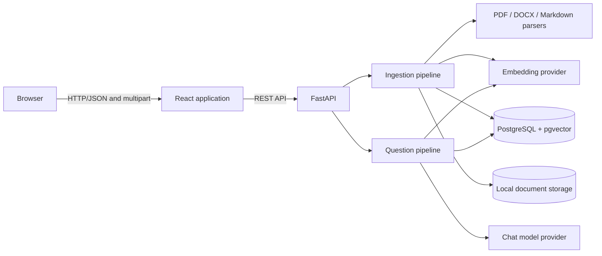

# Architecture

## Purpose

This application lets a local user upload a PDF, DOCX, or Markdown document and ask questions
whose answers are grounded in that document. The MVP is intentionally single-user and local. It
separates parsing, retrieval, and model-provider concerns so that each can be tested or replaced
independently.

## System context



The React client owns interaction state only. FastAPI validates requests and coordinates services.
PostgreSQL is the system of record for document metadata, chunks, embeddings, and retrieval
indexes. Original uploads are stored in the configured local upload directory.

## Backend boundaries

- **API:** transport validation, HTTP status mapping, and response serialization.
- **Services:** document lifecycle orchestration and transaction boundaries.
- **Extraction:** converts each supported file into ordered, structured blocks.
- **Chunking:** groups blocks using document structure and configured token limits.
- **Embeddings:** a provider interface with an OpenAI implementation and deterministic test fake.
- **Retrieval:** vector and full-text candidate generation, rank fusion, deduplication, and context
  selection.
- **Generation:** builds a grounded prompt, calls the chat provider, and returns an answer with
  citations or an insufficient-evidence result.
- **Repositories:** database access without HTTP or provider-specific behavior.

Provider clients must not make network calls during import. Tests inject deterministic providers.

## Observability harness

Tracing is behind the application-owned `Tracer` and `Span` interfaces. Business services depend
only on that small boundary; they do not import the OpenTelemetry SDK. The factory selects one of
two implementations:

- `NoOpTracer` is the default when observability is disabled. It creates no telemetry resources,
  starts no exporter, and makes no network requests.
- `OpenTelemetryTracer` owns an application-local SDK provider and an OTLP/HTTP exporter. It does
  not replace OpenTelemetry's process-global provider. A batch span processor exports spans away
  from the request path, and application shutdown closes the provider so buffered spans can flush.

The same tracer instance is stored on the FastAPI application, injected into document and RAG
services, and shut down once by the application lifespan. Tests can inject a no-op tracer or an SDK
adapter backed by an in-memory exporter without changing business code.

### Span topology

Every recognized HTTP request starts a route-level span with a templated route rather than the raw
URL. Upload traces normally have this shape:

```text
http.document.upload
└── document.upload
    ├── db.document.create
    ├── rag.ingest
    │   ├── db.document.status              (processing)
    │   ├── rag.extract
    │   ├── rag.chunk
    │   ├── rag.embedding.batch             (one per embedding batch)
    │   └── db.chunks.replace
    └── db.document.status                  (ready or failed)
```

A question trace is:

```text
http.document.question
└── document.question
    └── rag.question
        ├── rag.embedding.query
        ├── rag.retrieve
        ├── rag.generate                    (omitted when retrieval finds no evidence)
        └── db.question_event.create
```

Deletion uses `http.document.delete` → `document.delete` → `db.document.delete`. List, detail, and
health requests use `http.document.list`, `http.document.get`, and `http.health`. Unknown routes
use `http.request` with the route value `unmatched`, so arbitrary URL paths are not exported.

Useful attributes are deliberately structural: document UUID, media type, byte size and status;
chunk, batch, candidate, result and citation counts; embedding dimensions; provider model; HTTP
method, route template and response status. Exceptions mark spans as errors but record only the
exception type and whether it escaped—not the message, stack, arguments, or local variables. A
5xx HTTP response also marks its request span as an error.

### Privacy boundary

Trace attributes and event attributes pass through the same key filter. Keys containing any of
these case-insensitive terms are discarded after dots and hyphens are normalized to underscores:
`answer`, `api_key`, `authorization`, `content`, `document_text`, `filename`, `file_path`,
`password`, `prompt`, `question`, `secret`, and `token_value`. Consequently, traces must not contain
uploaded text, filenames or paths, questions, generated answers, prompts, credentials,
authorization headers, request bodies, query strings, or exception messages.

This is a key-based guardrail, not content inspection. Contributors must not place sensitive values
under a novel, apparently safe key. Export document UUIDs only where operational correlation is
required, and treat the telemetry backend as sensitive operational infrastructure.

## Main workflows

### Ingestion

1. Validate extension, media type, size, and non-empty content.
2. Save the upload using an application-generated filename rather than user input.
3. Create a `documents` record with a processing state.
4. Extract ordered blocks and source coordinates.
5. Normalize text, remove extraction artifacts where safe, and preserve structural metadata.
6. Create token-bounded chunks and enriched embedding text.
7. Embed in batches and persist chunks, vectors, and full-text search values.
8. Mark the document ready, or persist a safe failure state if processing fails.

The MVP processes uploads synchronously. The status model is retained so ingestion can move to a
worker later without changing the API representation.

### Question answering

1. Validate that the selected document exists and is ready.
2. Embed the question and retrieve semantic and keyword candidates scoped to that document.
3. Fuse rankings, deduplicate near-neighbor content, and select the final context.
4. Ask the chat provider to answer only from supplied context.
5. Return the answer and source metadata. If support is inadequate, return an explicit
   insufficient-evidence response rather than guessing.

## Persistence model

`documents` has one-to-many relationships with both `chunks` and `question_events`. Both child
tables declare `FOREIGN KEY ... ON DELETE CASCADE`, and the ORM delegates deletion to PostgreSQL
rather than loading and deleting children itself. This is a database guarantee: a raw SQL
`DELETE FROM documents ...` removes that document's chunks and question events in the same
transaction. Rows owned by every other document remain unchanged. UUIDs are used as public and
database identifiers. Every chunk stores:

- original and embedding-enriched text;
- sequence, token count, content type, and character offsets;
- heading path and PDF page range where known;
- parser-specific metadata in JSONB;
- a PostgreSQL full-text search value;
- a provider-configurable vector and its validated dimension.

Changing embedding spaces requires re-embedding existing content but no schema migration. The
template performs exact semantic retrieval within one document because a global HNSW index cannot
cover mixed dimensions safely. Fixed-space production deployments may add a dimension-specific
partial expression index. The full-text index uses GIN.

The application removes the corresponding local source file after the database delete succeeds.
That filesystem cleanup is coordinated by the document service and is not part of the database
cascade. A failed file unlink therefore cannot cause PostgreSQL to restore already-deleted rows.

## Metadata and traceability

Retrieval results retain document ID, chunk ID, filename, heading path, page range, excerpt, and
score. Locations may be absent when a format cannot supply them reliably. The application stores
parser and embedding configuration so that stale chunks can be identified after pipeline changes.
Original chunk text is kept separate from enriched embedding text to ensure displayed citations
match the source.

## Failure behavior

Client errors use explicit 4xx responses. Unexpected extraction or provider failures are exposed
with a safe message while the document records its failed state. Internal exceptions, provider
responses, secrets, and local paths must not be returned to the browser.

Telemetry export is best-effort and asynchronous. The application does not bundle a collector or
trace UI, and an unavailable collector must not become part of the request's success criteria.
Metrics and log export are outside the current harness.

## Security and trust boundaries

Uploaded documents and their contents are untrusted. The server must enforce allowlisted formats,
size limits, generated storage names, and path containment. Extracted text is data, not model
instructions; prompts explicitly tell the model to ignore instructions found in source documents.
The UI renders answers and excerpts as text, never unsanitized HTML.

The MVP has no authentication and should bind only to trusted local interfaces. It is not suitable
for internet exposure without authentication, authorization, rate limits, malware scanning,
tenant isolation, encrypted storage, and a production secret-management strategy.

## Evolution points

Likely post-MVP changes include asynchronous ingestion, multi-document collections, a reranker,
OCR for scanned PDFs, object storage, authenticated multi-tenancy, feedback/evaluation data, and
provider-independent model selection. The service and provider boundaries are intended to permit
these changes without rewriting the HTTP layer.
